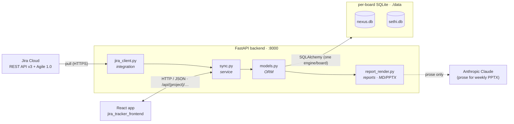
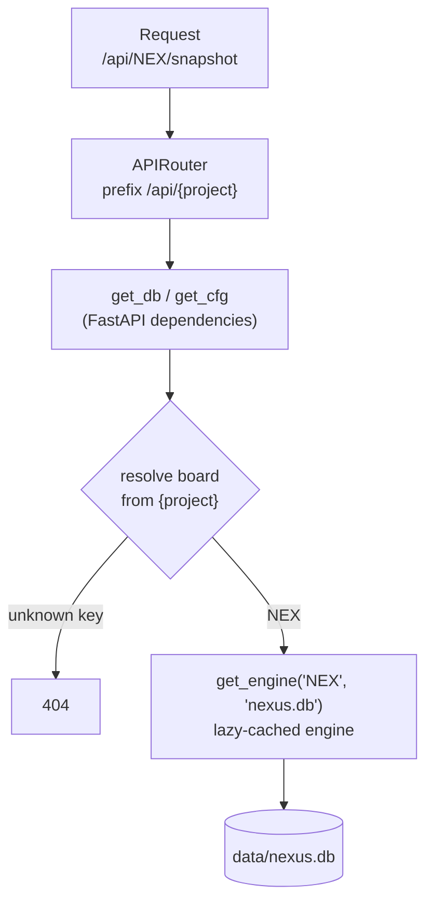
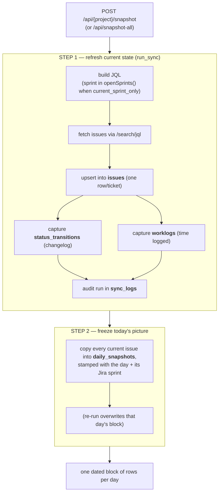

# Jira Tracker — Architecture

How the backend is built, how it pulls **multiple Jira boards** into **per-board databases**, how each
day's board is saved, and how the sprint reports & decks are generated.

> **v2 — multi-board.** Earlier versions were a single-board (NEX) tracker on one `jira_tracker.db`.
> The service now monitors several boards (NEX, STH), each in its **own** SQLite file, resolved
> from an `/api/{project}/…` path prefix.

---

## 1. The moving parts



The backend is **layered** — each module has one job:

| Layer | File(s) | Responsibility |
|---|---|---|
| API | `app/main.py` | HTTP endpoints, routing, CORS, request validation. Thin — parses requests, calls the service layer, shapes responses with Pydantic. No business logic or JQL. |
| Service | `app/sync.py` | Builds the JQL, normalizes Jira → our shape, upserts issues, captures **transitions + worklogs**, and freezes **snapshots**. Report aggregation math lives in `main.py` helpers. |
| Reports | `app/report_render.py` | Renders sprint-compare Markdown and the weekly QA **PPTX** deck; calls the LLM for prose only. |
| Integration | `app/jira_client.py` | The only module that knows Jira's wire format (auth, pagination, retries). Anti-corruption boundary — returns plain dicts. |
| Persistence | `app/models.py`, `app/database.py` | SQLAlchemy 2.0 ORM models + **one engine per board** (lazy-cached), plus hand-rolled additive migrations. |
| Config | `app/config.py`, `app/projects.py` | Shared secrets/settings from `.env`; the per-board registry from `projects.yaml`. Both hot-reload on file change. |
| Contracts | `app/schemas.py` | Pydantic v2 response models — the public API surface the React app consumes. |

**Stack:** Python 3.10+, **FastAPI** `0.115.6` on **Uvicorn** `0.34.0`, **SQLAlchemy** `2.0.36`,
**Pydantic** `2.10.4` + **pydantic-settings**, **httpx** for Jira, **anthropic** (LLM prose) and
**python-pptx** for decks. Storage is SQLite. No Alembic; no `pyproject.toml` (plain `requirements.txt`).

**Frontend:** Vite + React (`jira_tracker_frontend`) — a board switcher, a "sync" button, a date picker,
an assignee filter, and the board / report views.

---

## 2. Multi-board model

Every board this tracker watches is one block in `projects.yaml`; `app/projects.py` loads that registry.
Shared secrets (Jira credentials, `ANTHROPIC_API_KEY`, CORS) stay in `.env` — never in the YAML.



- **One engine + one SQLite file per board.** `app/database.py` builds engines lazily and caches them by
  board key (`_engines`), so boards can never be confused. Files live under `DATA_DIR` (default `./data`):
  `nexus.db`, `sethi.db`.
- **Board resolution.** The `{project}` path param is resolved by the `get_db` / `get_cfg` dependencies;
  an unknown key returns **404** before any DB file is touched. `get_cfg` yields a `ProjectConfig` that
  merges the shared `Settings` with that board's YAML overrides, so sync/report code just takes a `cfg`.
- **Fan-out endpoints.** `POST /api/sync-all` and `POST /api/snapshot-all` run every board **concurrently**
  via a `ThreadPoolExecutor` (`_run_for_all_boards`). Boards are fully isolated, so one board's failure is
  recorded but never aborts the others — these are the (external) **cron entry points**.
- **Add a board:** copy a block in `projects.yaml` (set `key` / `name` / `db_file` + team fields), then
  `POST /api/config/reload` or restart. No code change.

---

## 3. How a "pull" saves to the database

A sync-and-snapshot (`sync_and_snapshot()` in `sync.py`) runs two steps against one board's DB:



- Only the **current sprint** is pulled when `current_sprint_only` is set (per board). `sync.py`
  normalizes Jira's wire format (`_normalize`, `_adf_to_text` for rich text), buckets days/weeks in the
  board's `report_timezone` (default `Asia/Manila`), and reconstructs the **assignee-at-time** from the
  changelog so reports can attribute work to who owned a ticket when it moved.
- A **past-day** snapshot is guarded by `PastSnapshotError` unless `force=true`.
- Failures are **recorded** in `sync_logs`, never crashed.

---

## 4. The database tables

Each board's DB has the same schema:

```mermaid
erDiagram
    issues ||--o{ daily_snapshots : "copied & date-stamped each day"
    issues ||--o{ status_transitions : "changelog history"
    issues ||--o{ worklogs : "time logged"

    issues {
        string key PK "ticket no."
        string summary
        string status
        string assignee
        json raw "full Jira payload"
        datetime synced_at "overwritten every pull"
    }
    daily_snapshots {
        date snapshot_date PK "the day captured"
        string issue_key PK "ticket no."
        string status "column that day"
        string assignee
        string sprint_name "sprint on the board that day"
        datetime captured_at
    }
    status_transitions {
        int id PK
        string issue_key
        string changelog_id "uniq w/ issue_key"
        string from_status
        string to_status
        string moved_by
        string assignee_at "who owned it then"
        date change_date "local-tz day"
    }
    worklogs {
        int id PK
        string issue_key
        string worklog_id "uniq w/ issue_key"
        string author "who clocked the time"
        int time_spent_seconds
        datetime started
    }
```



| Table | Purpose |
|---|---|
| **`issues`** | Current state of every ticket. Upserted (overwritten) on every pull. Keeps the full Jira `raw` payload for future-proofing. |
| **`daily_snapshots`** | One row per ticket **per day** — the saved board picture (composite PK `snapshot_date` + `issue_key`). Append-only history; also records the Jira `sprint_name`/`start`/`end` the row came from. |
| **`status_transitions`** | One row per changelog status change. Stores both `moved_by` and `assignee_at`; unique on `(issue_key, changelog_id)` so re-sync is idempotent. Powers the per-assignee movement/scorecard reports. |
| **`worklogs`** | One row per Jira worklog entry, attributed to its **author**; `summary`/`web_url` denormalized so the time-log view survives a prune of `issues`. Unique on `(issue_key, worklog_id)`. |
| **`sync_logs`** | Audit row per run (counts, status, errors). |

**Key design point:** `daily_snapshots`' PK guarantees one immutable row per ticket per day; re-syncing
a day overwrites that day's block. This is the time machine that makes day-by-day comparison possible —
comparing two days is just a self-join on `issue_key`.

**Migrations:** there is **no Alembic**. `create_all()` builds missing tables; `_migrate_columns()` +
the `_ADDED_COLUMNS` map in `database.py` run idempotent `ALTER TABLE … ADD COLUMN` on startup so
existing DBs self-heal when a column is added.

---

## 5. API endpoints

FastAPI splits the surface into **global** endpoints (on `app`) and a **board-scoped** router
(`APIRouter(prefix="/api/{project}")`). Swagger UI is at `/docs`.

### Global (`meta` / all-boards)

| Method | Path | Purpose |
|---|---|---|
| GET | `/health` | Liveness — no Jira token needed. |
| POST | `/api/config/reload` | Re-read `.env` + `projects.yaml`, dispose cached engines. |
| GET | `/api/jira/ping` | Verify the Jira token against `/myself`. |
| GET | `/api/projects` | Configured boards (key + name) — powers the board switcher. |
| POST | `/api/sync-all` | Sync **every** board in parallel (cron entry point). |
| POST | `/api/snapshot-all` | Sync + snapshot every board in parallel (cron entry point). |

### Board-scoped — `/api/{project}/…`

| Group | Method | Path | Purpose |
|---|---|---|---|
| sync | POST | `/sync` | Pull this board; `?full=false` = only changes since last sync. |
| sync | GET | `/sync/history` | Recent sync runs. |
| issues | GET | `/issues` | List issues (filters: status, assignee, type, …). |
| issues | GET | `/issues/blocked` | Blocked tickets. |
| issues | GET | `/issues/{key}` | One issue. |
| issues | GET | `/meta` | Distinct statuses / assignees / types (filter options). |
| snapshots | POST | `/snapshot` | Sync + save today's snapshot. |
| snapshots | GET | `/snapshots` | Dates that have a snapshot (date picker). |
| snapshots | GET | `/snapshots/{date}` | The board exactly as it looked on that date. |
| reports | GET | `/reports/scorecard` | Per-assignee movement scorecard. |
| reports | GET | `/reports/column-flow` | Flow between board columns. |
| reports | GET | `/reports/assignee/{name}` | One person's scorecard. |
| reports | GET | `/reports/assignee/{name}/movement` | That person's ticket movements. |
| reports | GET | `/reports/assignee/{name}/worklog` | That person's logged time. |
| reports | GET | `/reports/sprint` | Sprint report data. |
| reports | GET | `/reports/sprint-compare` (+ `.md`) | Closing-vs-kickoff comparison (JSON or Markdown). |
| reports | GET | `/reports/weekly-activity` (+ `.md`, `.pptx`) | Weekly QA activity (JSON, Markdown, or a **PPTX deck**). |

---

## 6. Reports & deck generation

`app/report_render.py` turns report data into deliverables. **Every number/table is rendered
deterministically** from the data — the LLM only ever writes prose.

- **Sprint-compare (Markdown)** — `render_combined_markdown` builds one all-boards report (org roll-up +
  a per-board section). Its two prose sections come from **pre-authored narrative JSON**, so **no API key
  is required**.
- **Weekly QA deck (PPTX)** — `build_weekly_pptx` renders the themed deck via python-pptx.
  `_author_qa_narrative` asks Claude (the model configured by `ANTHROPIC_MODEL` in `.env`) for the prose
  sections via **structured JSON output**, grounded strictly in the data. With no key set it raises
  `LlmNotConfigured` → the `.pptx` endpoint returns **HTTP 503**.
- **CLI tools** in `scripts/` drive the deck pipeline outside FastAPI: `build_allboards_deck.py`,
  `generate_compare_decks.py`, `md_to_deck.py`, and the one-off `_backfill_transitions.py`.

---

## 7. Config & environment

- **`app/config.py`** — `Settings(BaseSettings)` reads `.env` (12-factor). Settings are **hot-reloaded**:
  cached against the `.env` mtime and re-read automatically when it changes (rotated tokens need no
  restart); `POST /api/config/reload` is the manual escape hatch. CSV env vars are parsed into lists via
  property helpers (`report_assignee_list`, `done_statuses`, …).
- **`app/projects.py`** — the board registry, parsed from `projects.yaml` and **hot-reloaded** on its own
  mtime. `ProjectConfig` merges shared `Settings` with a board's YAML overrides and re-exposes the same
  property surface, so sync/report code is board-agnostic.
- **Middleware:** **CORS only** (`CORSMiddleware`), configured once at startup from
  `cors_origin_list`. Unlike other settings, **changing CORS origins needs a restart**.
- **Auth:** there is **no inbound authentication** — this is a local/trusted-network tool. The only
  credential is the **outbound Jira API token** (basic auth, email + token) in `.env`.

---

## 8. Run it

```bash
# backend (from jira_tracker_backend/)
uvicorn app.main:app --reload --port 8000

# frontend (from jira_tracker_frontend/)
npm run dev
```

Open the frontend, pick a board, click **sync**, then pick a date and (optionally) an assignee. Swagger
lives at `http://localhost:8000/docs`. For scheduled captures, point cron at `POST /api/snapshot-all`.

---

## 9. Known doc/config drifts

- **PyYAML** is imported by `app/projects.py` but is **not pinned** in `requirements.txt` (currently
  resolved transitively). Worth pinning explicitly.
- **`README.md`** still describes the older **single-DB** design (`jira_tracker.db`, `JIRA_PROJECT=NEX`,
  un-prefixed `/api/…` routes). This document supersedes it for the current multi-board architecture.
